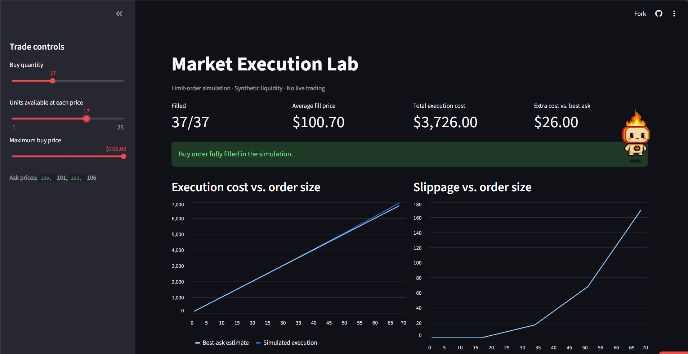

# Market Execution Lab

**Python order-matching simulator and interactive trade-execution dashboard.**

[**Live Dashboard**](https://market-execution-lab-wjvwntgj6naappxdfgxytb3.streamlit.app/) · [GitHub Repository](https://github.com/alexsergeev1/market-execution-lab)



## What it does

- Matches limit buy/sell orders using **price–time priority**
- Handles **partial fills**, remaining orders, and cancellations
- Validates order inputs and tracks executed trades
- Compares execution costs with an idealized best-ask estimate
- Lets users change order size, liquidity, and maximum buy price in a **Streamlit dashboard**
- Exports scenario data as CSV

## Example

| Available sell orders | Incoming buy order |
|---|---|
| 5 units at **$100**; 5 units at **$101** | Buy **8 units**, limit **$101** |

The simulator fills **5 × $100 + 3 × $101 = $803**.

- Average fill: **$100.375**
- Best-ask-only estimate: **$800**
- Extra execution cost: **$3**, excluding fees

This shows why actual fill prices can differ from a single best-price quote.

## Run it

Requires Python 3.11+.

```bash
git clone https://github.com/alexsergeev1/market-execution-lab.git
cd market-execution-lab
python -m venv .venv
```

**Windows PowerShell:**

```powershell
.\.venv\Scripts\python.exe -m pip install -r requirements.txt
.\.venv\Scripts\python.exe -m streamlit run app.py
```

**macOS / Linux:**

```bash
.venv/bin/python -m pip install -r requirements.txt
.venv/bin/python -m streamlit run app.py
```

## Tests and benchmarks

**30 automated pytest cases** cover input validation, price/time priority, partial fills, cancellations, and trade history.

```powershell
.\.venv\Scripts\python.exe -m pytest -q
.\.venv\Scripts\python.exe benchmark.py
```

The benchmark writes [measured results](results/benchmark_results.md), [timings](results/benchmark_latency.csv), and a [scaling chart](results/benchmark_scaling.png). Results are generated on the machine running the test, not claimed as universal performance.

## Files

| File | Role |
|---|---|
| `models.py` | Orders and input validation |
| `orderbook.py` | Matching engine and trade records |
| `app.py` | Interactive Streamlit dashboard |
| `plot_cost.py` | Static charts and CSV |
| `demo.py` | Reproducible $803 example |
| `test_*.py` | Automated tests |
| `benchmark.py` | Repeatable performance checks |

## Scope

An **educational, in-memory simulator** using four synthetic ask-price levels in the dashboard. No live market feed, real orders, trading profits, network latency, commissions, or realistic market-impact model. The benchmark is single-process Python and is **not** a production-exchange latency claim.

**Stack:** Python · Streamlit · pandas · matplotlib · pytest
