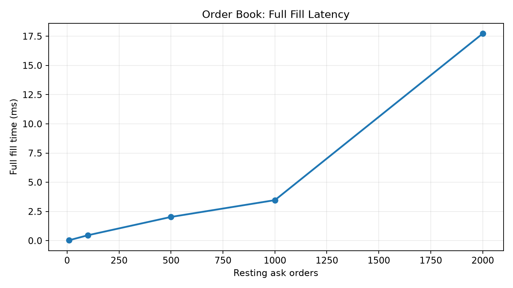

# Performance benchmark

Run: 2026-11-03 20:19 UTC
Python: 3.11.9
OS: Windows-10-10.0.26200-SP0

## Alternating buy/sell submissions
**102,100 orders/sec** (median of 5 runs; 5,000 sell/buy pairs per run).

## Full-order fill time

| Resting asks / trades filled | Median (ms) | p95 (ms) |
|---:|---:|---:|
| 10 | 0.0379 | 0.0510 |
| 100 | 0.4633 | 0.5524 |
| 500 | 2.0311 | 3.1858 |
| 1,000 | 3.4697 | 4.9760 |
| 2,000 | 17.7248 | 21.0878 |

Benchmarks use synthetic, in-memory orders on one Python process.
The full-fill timer excludes book setup and includes all fills for one incoming buy order.
The throughput test alternates a one-unit sell and an immediately matching buy; it is a simple best-case workload.
No network, persistence, fees, or production exchange infrastructure are included.
Numbers depend on hardware and background load; not suitable for comparing exchange systems.

